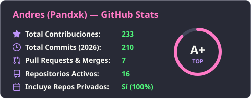
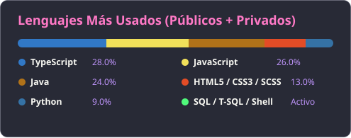
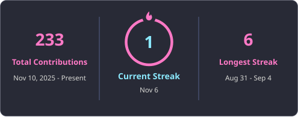

# ¡Hola! Soy Andres (Pandxk) 👋

  
  
  

---

## 👨‍💻 Sobre mí

- 🚀 **Desarrollador Full-Stack & Móvil** enfocado en construir aplicaciones web modernas, sistemas de gestión y herramientas de alto rendimiento.
- 🤖 Experiencia desarrollando **bots automatizados, scrapers en tiempo real y soluciones con IA** en **Python, TypeScript y Node.js** con despliegues en la nube (**AWS EC2**).
- 🏗️ Diseño e implementación de **APIs RESTful**, arquitecturas orientadas a servicios y bases de datos relacionales y NoSQL.
- 💡 Siempre explorando nuevas tecnologías, optimizando el rendimiento y aplicando buenas prácticas de ingeniería de software.

 

---

## 🛠️ Stack Tecnológico y Herramientas

### 💻 Lenguajes de Programación

  
  
  
  
  

### 🎨 Desarrollo Frontend, Móvil e Interfaces

  
  
  
  
  

### ⚙️ Backend, Bases de Datos y Cloud

  
  
  
  
  
  
  
  

### 🖥️ Entornos y Control de Versiones

  
  
  
  
  

---

## 🚀 Proyectos Destacados

| Proyecto | Descripción | Tecnologías |
| :--- | :--- | :--- |
| 📈 **[arbitrage-scanner](https://github.com/Pandxk/arbitrage-scanner)** | Bot automatizado para escaneo de cuotas deportivas en tiempo real, detección de *Value Bets* y oportunidades de arbitraje con alertas vía Telegram desplegado en AWS EC2. | `Python` `AWS EC2` `Telegram API` |
| 🖼️ **[WebOptimizer](https://github.com/Pandxk/WebOptimizer)** | Herramienta local y web para optimización masiva de imágenes con redimensionado inteligente, limpieza de metadatos y conversión a WebP (hasta 85% de reducción de peso). | `Python` `Gradio` `WebP` |
| 🔗 **[System-Api-Rest](https://github.com/Pandxk/System-Api-Rest)** | Arquitectura de servicios y API REST modular tipada para gestión e integración de recursos. | `TypeScript` `Node.js` `REST API` |
| 🛠️ **[Sistema-Gestion-Mecanica](https://github.com/Pandxk/Sistema-Gestion-Mecanica)** | Sistema integral orientado a objetos para la administración de órdenes de trabajo, inventario y clientes de taller mecánico. | `Java` `POO` `SQL` |

---

## 📊 Estadísticas de GitHub

  
  

  

---

## 📫 Cómo contactarme

  
  
  

